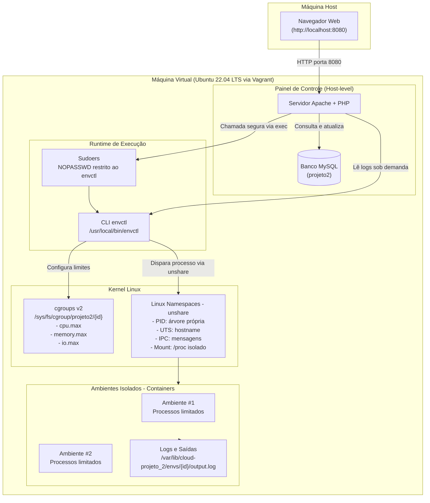

# ☁️ Projeto 2: Ambientes de Execução com Namespaces e Cgroups v2

> **Computação em Nuvem** • Implementação de um *Container Runtime* simplificado com interface Web para gerenciamento e isolamento de processos sob demanda.

---

## 📋 Sumário

- [Visão Geral](#-visão-geral)
- [Arquitetura do Sistema](#-arquitetura-do-sistema)
- [Tecnologias Utilizadas](#-tecnologias-utilizadas)
- [Estrutura do Repositório](#-estrutura-do-repositório)
- [Pré-requisitos](#-pré-requisitos)
- [Instalação e Inicialização Rápida](#-instalação-e-inicialização-rápida)
- [Como Utilizar a Interface Web](#-como-utilizar-a-interface-web)
- [O Script Auxiliar `envctl` (CLI)](#-o-script-auxiliar-envctl-cli)
- [Roteiro de Testes e Validação de Recursos](#-roteiro-de-testes-e-validação-de-recursos)
- [Segurança e Boas Práticas](#-segurança-e-boas-práticas)
- [Guia Teórico para Apresentação e Arguição](#-guia-teórico-para-apresentação-e-arguição)
- [Autores](#-autores)

---

## 🎯 Visão Geral

Este projeto foi desenvolvido para a disciplina de **Computação em Nuvem**, com o propósito de demonstrar na prática os fundamentos de **virtualização a nível de sistema operacional (containers)** sem depender de ferramentas prontas como Docker, Podman ou containerd.

A solução é composta por:
1. **Infraestrutura provisionada via Vagrant**: Uma máquina virtual Ubuntu 22.04 LTS (kernel 5.15 com suporte nativo a **cgroups v2**).
2. **Painel de Controle Web (Apache + PHP + MySQL)**: Interface intuitiva para submissão de scripts ou comandos, definição de cotas de recursos de hardware e acompanhamento do ciclo de vida das execuções.
3. **Container Runtime (`bin/envctl`)**: Script que interage diretamente com o Linux Kernel, aplicando isolamento de visibilidade através de **Namespaces** (`unshare`) e restrições rigorosas de hardware via **cgroups v2** (CPU, Memória RAM com Swap desativado, e I/O de disco).

---

## 🏗️ Arquitetura do Sistema


### Divisão de Responsabilidades

| Componente | Onde Roda | Função Principal |
| :--- | :--- | :--- |
| **VM Ubuntu 22.04** | VirtualBox gerenciado por Vagrant | Hospeda toda a infraestrutura com kernel Linux moderno (5.15) e cgroups v2. |
| **Apache + PHP 8.1** | Direto na VM (`systemd`) | Serve a interface web, orquestra requisições e executa chamadas seguras ao `envctl`. |
| **MySQL 8.0** | Direto na VM (`systemd`) | Persiste scripts reutilizáveis e histórico de ambientes criados e seus estados. |
| **Script `envctl`** | Direto na VM (como `root`) | Cria grupos cgroup, define cotas de recursos, dispara processos com `unshare`, monitora status e limpa recursos. |
| **Ambientes (Containers)** | Dentro dos Namespaces + Cgroups | Execução isolada dos scripts de usuário com limites impostos pelo kernel. |

---

## 🛠️ Tecnologias Utilizadas

- **Infraestrutura como Código (IaC)**: [Vagrant](https://www.vagrantup.com/) + [VirtualBox](https://www.virtualbox.org/)
- **Sistema Operacional**: Ubuntu 22.04 LTS (*Jammy Jellyfish*)
- **Isolamento de Recursos**:
  - **Linux Namespaces**: `unshare` (`--pid`, `--fork`, `--mount-proc`, `--uts`, `--ipc`)
  - **Control Groups**: `cgroups v2` (`cpu.max`, `memory.max`, `memory.swap.max`, `io.max`, `cgroup.procs`, `cgroup.kill`)
- **Web Stack & Backend**: Apache 2.4, PHP 8.1, PDO MySQL
- **Banco de Dados**: MySQL Server 8.0
- **Frontend**: HTML5, Bootstrap 5.3, Bootstrap Icons

---

## 📁 Estrutura do Repositório

```text
cloud-proj-02/
├── Vagrantfile               # Configuração da VM (1 vCPU, 4GB RAM, redes e portas)
├── provision/
│   └── bootstrap.sh          # Script de provisionamento idempotente da VM
├── bin/
│   └── envctl                # Motor CLI para gerenciamento dos ambientes (Namespaces + Cgroups)
├── DB/
│   └── schema.sql            # Definição do banco de dados e tabelas (scripts, ambientes)
├── web/
│   ├── index.php             # Painel principal: listagem de ambientes ativos e status em tempo real
│   ├── novo.php              # Formulário de criação de ambientes e injeção de scripts
│   ├── acoes.php             # Controlador POST para ações de parada (stop) e exclusão (remove)
│   ├── logs.php              # Visualizador em estilo terminal para logs de saída (output.log)
│   ├── db.php                # Conexão PDO, sincronizador de status e wrapper seguro para o envctl
│   ├── header.php            # Cabeçalho padrão, barra de navegação e exibição de flash messages
│   └── footer.php            # Rodapé e scripts do Bootstrap
└── README.md                 # Documentação completa do projeto
```

---

## ⚙️ Pré-requisitos

Antes de iniciar, certifique-se de ter instalado em sua máquina hospedeira:
- [VirtualBox](https://www.virtualbox.org/wiki/Downloads) (versão 6.1 ou 7.0+)
- [Vagrant](https://developer.hashicorp.com/vagrant/downloads) (versão 2.2 ou superior)
- Git instalado e conexão à internet ativa (para baixar a box do Ubuntu e os pacotes necessários)

---

## 🚀 Instalação e Inicialização Rápida

1. **Clone o repositório:**
   ```bash
   git clone https://github.com/PedroGaspdev/cloud-proj-02.git
   cd cloud-proj-02
   ```

2. **Inicie e provisione a Máquina Virtual:**
   ```bash
   vagrant up
   ```
   > ⏳ O provisionamento automático (`provision/bootstrap.sh`) instalará os serviços (Apache, PHP, MySQL, util-linux), clonará o repositório em `/opt/cloud-projeto_2`, configurará permissões de sudoers e montará a estrutura inicial de cgroups.

3. **Acesse a aplicação no navegador:**
   - Via porta redirecionada: **[http://localhost:8080/cloud-projeto_2/](http://localhost:8080/cloud-projeto_2/)**
   - Ou via IP privado da VM: **[http://192.168.56.10/cloud-projeto_2/](http://192.168.56.10/cloud-projeto_2/)**

4. **Acessando a VM via SSH:**
   ```bash
   vagrant ssh
   ```

5. **Comandos úteis do dia a dia:**
   ```bash
   vagrant provision          # Reroda o script de provisionamento sem recriar a VM
   vagrant reload --provision # Reinicia a VM e roda o provisionamento novamente
   vagrant halt               # Desliga a VM
   vagrant destroy -f         # Destrói a VM completamente
   ```

---

## 💻 Como Utilizar a Interface Web

### 1. Painel Principal (`index.php`)
- Exibe todos os ambientes cadastrados que não foram excluídos.
- Mostra ID, nome, script associado, cotas de hardware (CPU %, RAM MB, I/O MB/s) e data de criação.
- **Status em Tempo Real**: Toda vez que a página é carregada, o status dos ambientes em execução é sincronizado diretamente com o cgroup do kernel Linux:
  - 🟢 **Executando**: Há processos ativos dentro do cgroup correspondente.
  - ⚪ **Terminado**: Processo finalizou com sucesso (`exit_code = 0`) ou foi parado manualmente.
  - 🔴 **Erro (OOM / Falha)**: Processo abortado por excesso de recursos (OOM Killer) ou código de saída diferente de 0.
- **Ações disponíveis**:
  - `Logs`: Abre o visualizador de saída do terminal.
  - `Parar`: Envia sinal de interrupção atômica para todos os processos do cgroup.
  - `Remover` (ícone de lixeira): Encerra a execução, remove o cgroup do kernel e apaga os dados locais.

### 2. Criação de Novo Ambiente (`novo.php`)
Permite configurar:
- **Nome de Identificação**: Rótulo amigável (o sistema gera automaticamente um ID seguro no formato `slug-YYYYMMDD-hash`).
- **Limites de Recursos (cgroups v2)**:
  - **CPU**: Limite percentual de 1 núcleo (1% a 100%).
  - **Memória RAM**: Limite estrito em MB (16 MB a 4096 MB) com Swap zerado.
  - **I/O de Disco**: Taxa máxima de transferência de leitura e escrita direta no disco (1 MB/s a 1000 MB/s).
- **Programa a Executar (3 opções)**:
  - **Digitar Comandos**: Escreva diretamente no navegador comandos Bash (com botões de atalho para exemplos prontos).
  - **Enviar Arquivo (.sh)**: Faça upload de um script shell do seu computador (as quebras de linha Windows CRLF são convertidas para LF automaticamente).
  - **Script Já Salvo**: Reutilize scripts que foram enviados anteriormente em outros ambientes.

### 3. Visualizador de Logs (`logs.php`)
- Exibe em um terminal escuro as **últimas 200 linhas** do arquivo `output.log` do ambiente selecionado.
- Suporta tanto programas de execução rápida quanto **serviços contínuos (daemons)**.
- Possui botão de atualização rápida e rolagem automática para a linha mais recente.

---

## ⚡ O Script Auxiliar `envctl` (CLI)

O script `bin/envctl` é o cérebro do runtime. Instalado em `/usr/local/bin/envctl` com permissão de execução, ele pode ser chamado diretamente via terminal na VM como `root` ou através do `sudo` restrito configurado para o Apache.

### Sintaxe Básica:
```bash
sudo envctl <create|status|log|stop|remove> <id> [parâmetros...]
```

### Comandos Suportados:

| Comando | Sintaxe | Descrição |
| :--- | :--- | :--- |
| `create` | `envctl create <id> <cpu_%> <mem_MB> <io_MBps> <script>` | Cria o subdiretório do cgroup, define os limites de hardware, move o processo para dentro do cgroup e dispara o `unshare` em background gravando a saída no log. |
| `status` | `envctl status <id>` | Retorna `executando`, `terminado` ou `erro` com base nos processos em `cgroup.procs` e no arquivo de código de saída. |
| `log` | `envctl log <id>` | Exibe as últimas 200 linhas do arquivo de log do ambiente. |
| `stop` | `envctl stop <id>` | Marca o ambiente como finalizado e escreve `1` em `cgroup.kill` para encerrar todos os processos do grupo de forma atômica. |
| `remove` | `envctl remove <id>` | Mata processos remanescentes via `cgroup.kill`, remove o cgroup do kernel (`rmdir`) e exclui a pasta de logs do ambiente. |

---

## 🧪 Roteiro de Testes e Validação de Recursos

Abaixo estão os testes práticos para demonstrar o cumprimento de cada requisito de isolamento e restrição de recursos (podem ser testados pela interface web ou via terminal com `vagrant ssh`):

### 1. Teste de Limite de CPU (ex.: Cota de 20%)
- **Script executado**:
  ```bash
  while true; do :; done
  ```
- **Como validar**:
  Abra um terminal na VM (`vagrant ssh`) e execute `top`. Observe que o uso da CPU para a thread do script oscilará estritamente próximo ao limite configurado (ex.: ~20%).

### 2. Teste de Limite de Memória e OOM-Killer (ex.: Cota de 100 MB)
- **Script executado**:
  ```bash
  python3 -c "a = ' ' * 300_000_000"
  ```
- **Como validar**:
  O Python tentará alocar ~300 MB de RAM. Como o limite foi configurado em 100 MB e o swap está desativado (`memory.swap.max = 0`), o kernel acionará o **OOM-Killer**. O processo será abortado com código `137` e o status na interface web mudará para **Erro (OOM / Falha)**.
  No terminal, confira o contador de OOM do cgroup:
  ```bash
  cat /sys/fs/cgroup/projeto2/<id>/memory.events
  # Exibe: oom_kill 1
  ```

### 3. Teste de Limite de I/O de Disco (ex.: Cota de 5 MB/s)
- **Script executado**:
  ```bash
  dd if=/dev/zero of=teste.bin bs=1M count=50 oflag=direct
  ```
- **Como validar**:
  O parâmetro `oflag=direct` força o I/O direto sem buffer de cache em RAM. O utilitário `dd` reportará uma taxa de escrita limitada a aproximadamente ~5 MB/s.

### 4. Teste de Isolamento de Processos (Namespace PID)
- **Script executado**:
  ```bash
  ps aux
  ```
- **Como validar**:
  No log da execução, observe que o ambiente enxerga apenas os seus próprios processos (o bash e o `ps`), onde o comando principal assume o papel de **PID 1** dentro do namespace. Todos os processos da máquina hospedeira e de outros ambientes permanecem invisíveis.

### 5. Teste de Isolamento de Hostname (Namespace UTS)
- **Script executado**:
  ```bash
  hostname ambiente-teste
  hostname
  ```
- **Como validar**:
  O comando exibirá o novo hostname `ambiente-teste` internamente. No entanto, no terminal da VM, ao rodar `hostname`, o nome da máquina permanece inalterado (`runtime-conteiner`).

### 6. Teste de Serviço Contínuo (Daemon)
- **Script executado**:
  ```bash
  while true; do
      echo "[$(date '+%H:%M:%S')] Servico ativo..."
      sleep 2
  done
  ```
- **Como validar**:
  O ambiente permanece com status **Executando**. Clicando no botão `Logs` e depois em `Atualizar`, novas linhas de saída aparecem a cada segundo sem interrupção.

---
